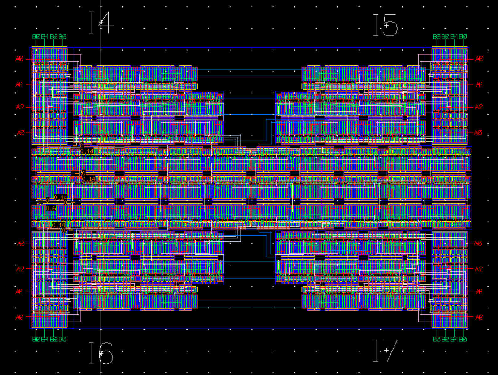
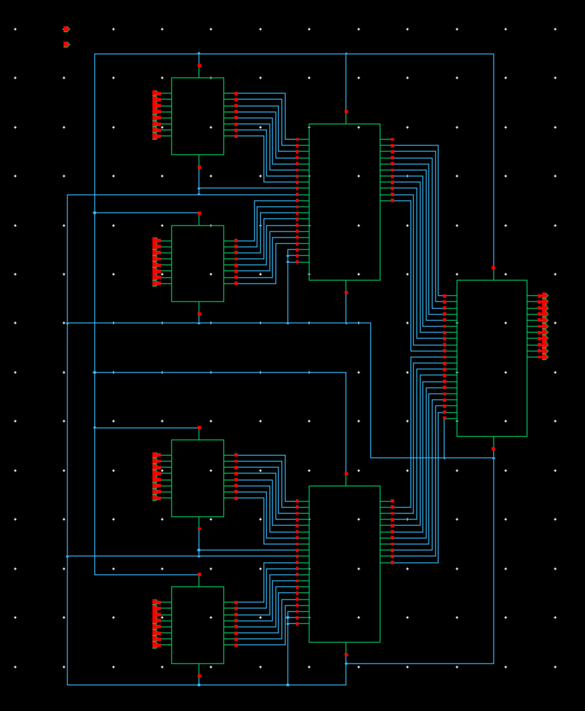
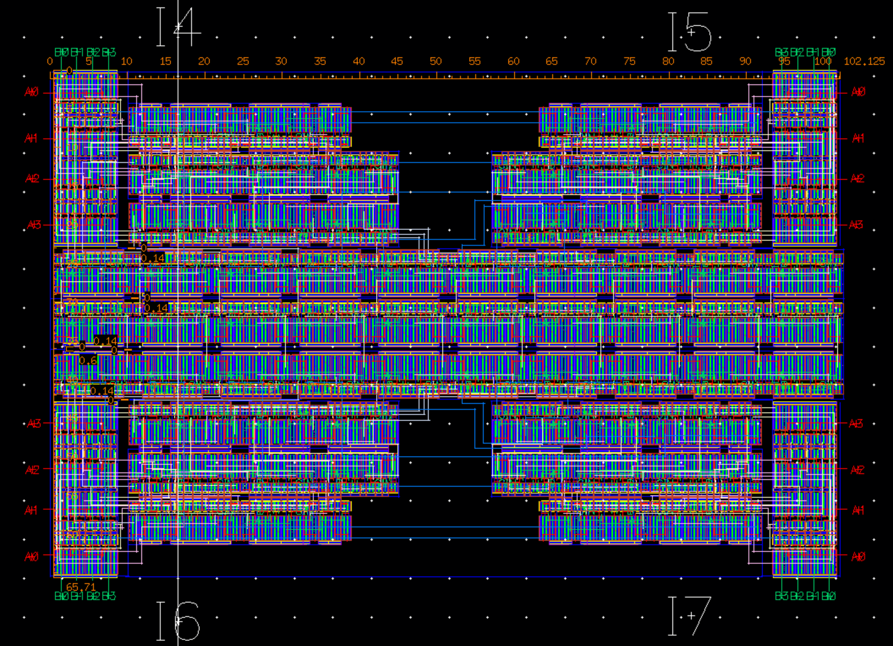
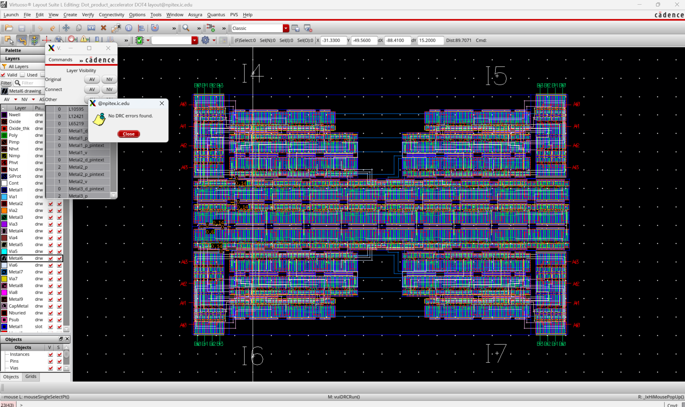
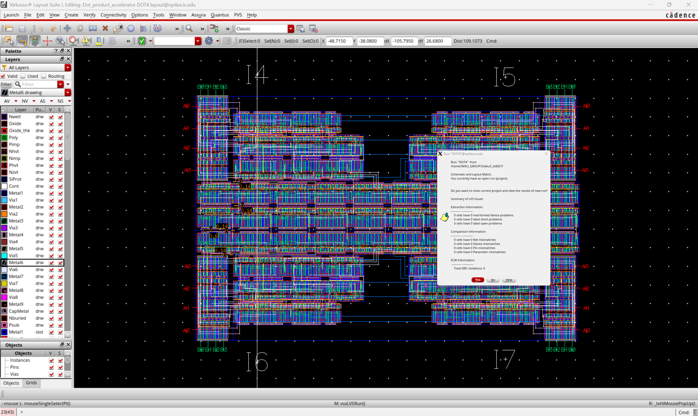
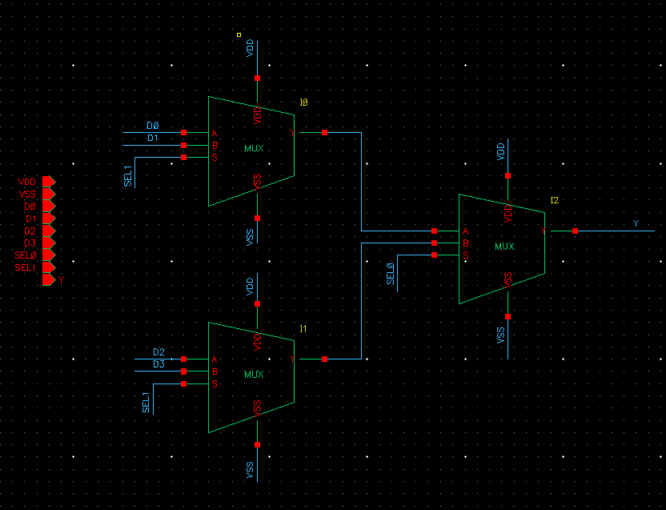
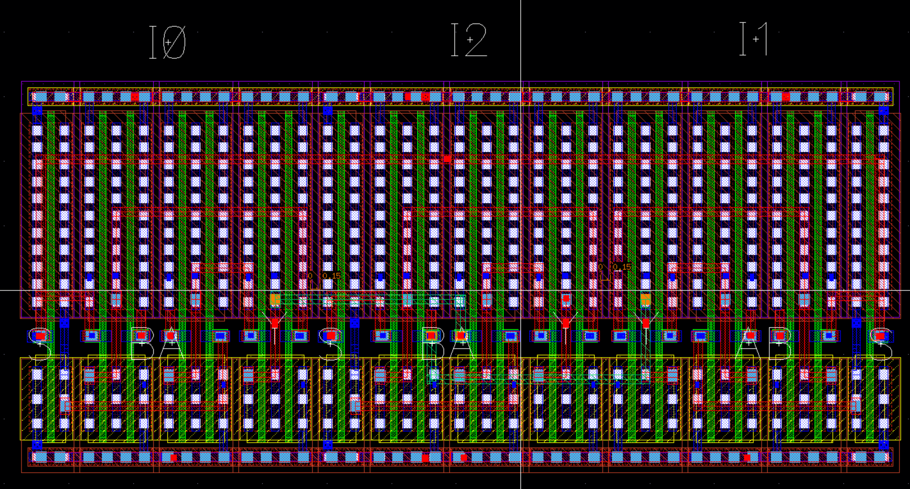
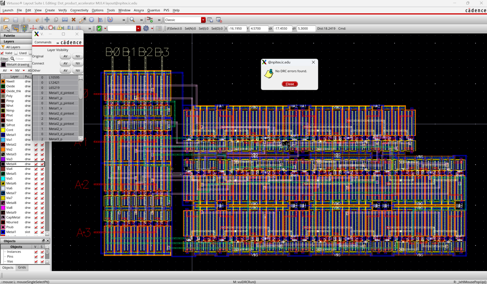
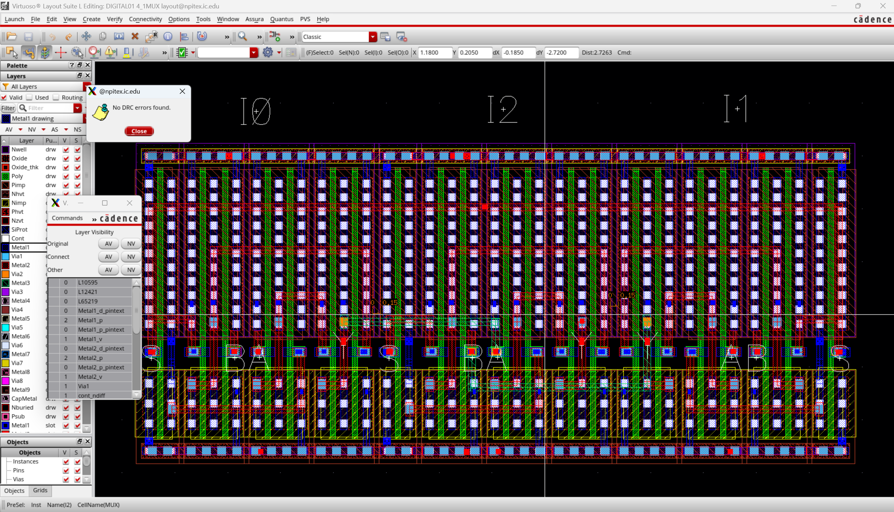
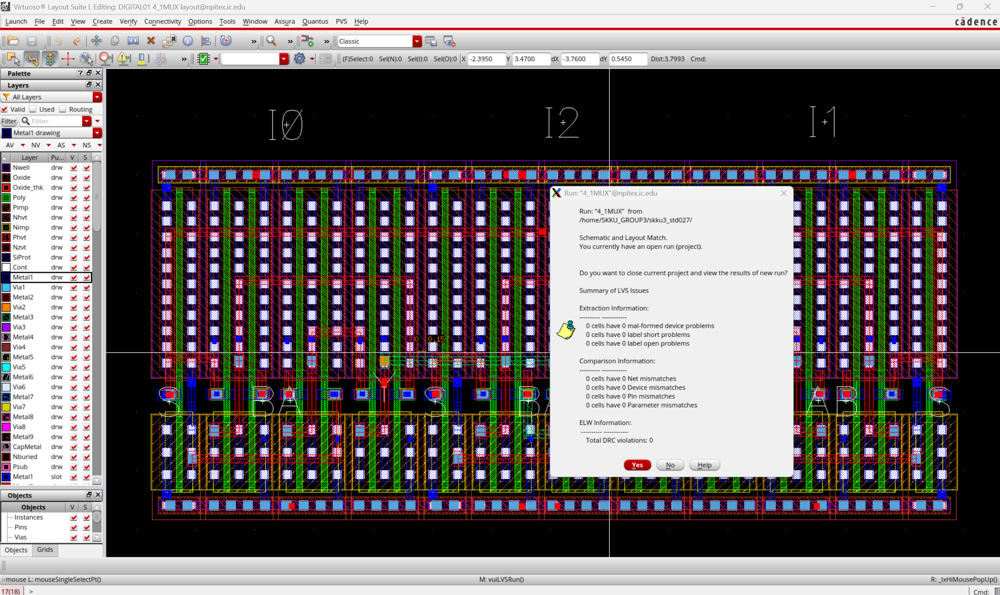

# Full-Custom IC Design

A Cadence Virtuoso design project spanning transistor-level CMOS cells, arithmetic circuits, sequential logic, and an unsigned INT4 dot-product accelerator for CNN workloads. The repository brings together schematics, physical layouts, simulation waveforms, and design notes.

The main architecture study compares a **sequential multiply–accumulate (MAC)** datapath with a **parallel four-term dot-product accelerator**.

[Architecture](#architecture-overview) · [Top-Level Layout](#top-level-accelerator) · [MUL4](#4-bit-multiplier-mul4) · [Arithmetic Cells](#arithmetic-cells) · [Logic Cells](#cmos-logic-cells) · [Sequential Logic](#sequential-logic) · [Multiplexers](#multiplexers) · [PCell](#parameterized-cell-pcell)

Images link directly to their original files. Click a schematic or layout to inspect its wiring at full resolution.

## Architecture Overview

```text
Y = X0*W0 + X1*W1 + X2*W2 + X3*W3

Xi, Wi : 4-bit unsigned operands
Pi     : 8-bit product
Y      : 10-bit dot-product result
```

Each product is at most 15 × 15 = 225. Summing four products gives a maximum of 900, so the accumulation and adder-tree datapaths use 10 bits. Multiplier outputs are zero-extended from 8 to 10 bits before addition.

```text
CMOS gates                         Storage and selection
INV / NAND / NOR / AND / OR / XOR   Latches / DFF / MUX
             |
       Half adder / Full adder
             |
        +----+----------------+
        |                     |
       MUL4                 RCA10
        |                     |
        +----------+----------+
                   |
        +----------+------------------+
        |                             |
  Sequential MAC              Parallel dot product
  MUL4 + RCA10 + REG10        4 x MUL4 + 3 x RCA10
```

## Top-Level Accelerator

The parallel accelerator computes four products concurrently and combines them with a two-stage adder tree. The first stage adds pairs of products; the second stage adds the two intermediate sums.

```text
X0, W0 --> MUL4 --> P0 --+
                         +--> RCA10 --> S01 --+
X1, W1 --> MUL4 --> P1 --+                     |
                                               +--> RCA10 --> Y[9:0]
X2, W2 --> MUL4 --> P2 --+                     |
                         +--> RCA10 --> S23 --+
X3, W3 --> MUL4 --> P3 --+
```

### Complete Layout

The top-level layout shows four multiplier regions and the interconnecting adder datapath.

[](AI_semiconductor_design/DOT_PRODUCT_ACCELERATOR_LAYOUT.png)

### Top-Level Schematic

[](AI_semiconductor_design/DOT_PRODUCT_ACCELERATOR_SCHEMATIC.png)

<details>
<summary>Top-level layout dimensions and physical-verification screenshots</summary>

**Layout dimensions**

[](AI_semiconductor_design/DOT_PRODUCT_ACCELERATOR_LAYOUT_SIZE.png)

**DRC view**

[](AI_semiconductor_design/DOT_PRODUCT_ACCELERATOR_LAYOUT_DRC.png)

**LVS view**

[](AI_semiconductor_design/DOT_PRODUCT_ACCELERATOR_LAYOUT_LVS.png)

</details>

[Project presentation](AI_semiconductor_design/Design%20of%20an%20INT4%20Dot%20Product%20Accelerator%20for%20CNN.pdf)

## Sequential MAC and Parallel Computation

The sequential MAC reuses one multiplier and one adder. A 10-bit register stores the running sum and feeds it back for the next accumulation. After reset initializes the accumulator to zero, each clocked update adds one product.

```text
ACC_next = ACC_current + zero_extend(Xi * Wi)

Cycle 1: ACC = X0*W0
Cycle 2: ACC = X0*W0 + X1*W1
Cycle 3: ACC = X0*W0 + X1*W1 + X2*W2
Cycle 4: ACC = X0*W0 + X1*W1 + X2*W2 + X3*W3
```

| Component | Sequential MAC | Parallel Dot Product |
| --- | --- | --- |
| 4-bit multipliers | 1 | 4 |
| 10-bit ripple-carry adders | 1 | 3 |
| Accumulator register | REG10: 10 D flip-flops | No accumulator feedback |
| Four-term computation | Four accumulation cycles | One combinational evaluation |
| Datapath organization | Register feedback | Two-stage adder tree |
| Main trade-off | Arithmetic hardware reuse | Concurrent arithmetic |

## 4-bit Multiplier (MUL4)

MUL4 multiplies two unsigned 4-bit inputs and produces an 8-bit result. Sixteen AND-based partial products feed a three-stage addition network containing **four half adders and eight full adders**.

```text
PP(i,j) = A(i) AND B(j)

A[3:0], B[3:0]
      |
16 partial products
      |
HA / FA addition network
      |
   P[7:0]
```

### Multiplier Layout

[](MUL4/MUL4_layout.png)

### Complete Multiplier Schematic

[](MUL4/MUL4_total_schematic.png)

<details>
<summary>Multiplier sub-blocks and internal connections</summary>

**Partial-product schematic**

[](MUL4/MUL4_schematic_bitline_16xMUL1.png)

**Three-stage addition schematic**

[](MUL4/MUL4_schematic_stage1%2C2%2C3.png)

**AND block layout**

[](MUL4/MUL4_AND_BLOCK.png)

**Adder block layout**

[](MUL4/MUL4_ADDER_BLOCK.png)

</details>

### Multiplier Simulation

The bus waveform below presents the input operands and product together. In the displayed sequence, B is held at binary 0010 while A changes, and the product bus follows the corresponding multiplication results.

[](MUL4/MUL4_sim_measurements_analogtodigital.png)

[Detailed MUL4 design and connection tables](MUL4/MUL4_design_project.md)

## Arithmetic Cells

Half adders and full adders form the multiplier reduction network. A chain of ten full adders forms RCA10, with each carry output connected to the next bit's carry input.

```text
Half adder:
  SUM  = A XOR B
  COUT = A AND B

Full adder:
  SUM  = A XOR B XOR CIN
  COUT = (A AND B) OR ((A XOR B) AND CIN)

RCA10:
  FA0 --> FA1 --> ... --> FA9
           carry propagation
```

<details>
<summary>Half Adder</summary>

The half adder produces a sum and carry from two input bits.

**Schematic**

[](HALFADDER/HALFADDER_schematic.png)

**Layout**

[](HALFADDER/HALFADDER_layout.png)

[Design notes](HALFADDER/HALFADDER_study.md)

</details>

<details>
<summary>Full Adder</summary>

The full adder adds two data bits and an incoming carry. Its sum and carry outputs support both multiplier reduction and ripple-carry addition.

**Schematic**

[](FULLADDER/FULLADDER_schematic.png)

**Layout**

[](FULLADDER/FULLADDER_layout.png)

[Design notes](FULLADDER/FULLADDER_study.md)

</details>

<details>
<summary>Full-adder routing and metal-layer views</summary>

**Connection view**

[](FULLADDER/FULLADDER_connection.png)

**Metal 3 view**

[](FULLADDER/FULLADDER_metal3.png)

**Metal 4 view**

[](FULLADDER/FULLADDER_metal4.png)

</details>

## CMOS Logic Cells

The gate library supplies inversion, partial-product generation, sum logic, carry logic, and the logic functions used by storage and selection circuits. Expand a cell to see its original schematic and layout.

<details>
<summary>Inverter</summary>

A complementary PMOS/NMOS pair implements logical inversion.

**Schematic**

[](Inverter/inverter_schematic.png)

**Layout**

[](Inverter/inverter_LVS.png)

[Design notes](Inverter/Inverter_study.md)

</details>

<details>
<summary>NAND</summary>

The NAND cell implements an inverted AND function.

**Schematic**

[](NAND/NAND_schematic.png)

**Layout**

[](NAND/NAND_layout.png)

[Design notes](NAND/NAND_study.md)

</details>

<details>
<summary>NOR</summary>

The NOR cell implements an inverted OR function.

**Schematic**

[](NOR/NOR_schematic.png)

**Layout**

[](NOR/NOR_layout.png)

[Design notes](NOR/NOR_study.md)

</details>

<details>
<summary>AND</summary>

AND logic generates the multiplier's one-bit partial products.

**Schematic**

[](AND/AND_schematic.png)

**Layout**

[](AND/AND_layout.png)

[Design notes](AND/AND_study.md)

</details>

<details>
<summary>OR</summary>

OR logic combines carry-generation terms.

**Schematic**

[](OR/OR_schematic.png)

**Layout**

[](OR/OR_layout.png)

[Design notes](OR/OR_study.md)

</details>

<details>
<summary>XOR</summary>

XOR logic generates half-adder and full-adder sum terms.

**Schematic**

[](XOR/XOR_schematic.png)

**Layout**

[](XOR/XOR_layout.png)

[Design notes](XOR/XOR_study.md)

</details>

## Sequential Logic

The storage circuits progress from cross-coupled SR latches to gated latches and an edge-triggered D flip-flop. The DFF design notes describe a master–slave structure with opposite clock phases. Ten D flip-flops provide the register width used by the sequential MAC accumulator.

<details>
<summary>NAND SR Latch</summary>

Cross-coupled NAND gates provide a state-holding feedback structure.

**Schematic**

[](SR_Latch_NAND/SR_LATCH_NAND_schematic.png)

**Layout**

[](SR_Latch_NAND/SR_LATCH_NAND_layout.png)

[Design notes](SR_Latch_NAND/SR_Latch_NAND_study.md)

</details>

<details>
<summary>NOR SR Latch</summary>

Cross-coupled NOR gates provide the NOR-based SR storage circuit.

**Schematic**

[](SR_Latch_NOR/SRLATCHNOR_schematic.png)

**Layout**

[](SR_Latch_NOR/SRLATCHNOR_layout.png)

[Design notes](SR_Latch_NOR/SR_Latch_NOR_study.md)

</details>

<details>
<summary>Gated SR Latch</summary>

Gating controls when the set/reset inputs affect the stored state.

**Schematic**

[](GATED_SR_Latch/GATEDSRLATCH_schematic.png)

**Layout**

[](GATED_SR_Latch/GATEDSRLATCH_layoutLVS.png)

[Design notes](GATED_SR_Latch/GATED_SR_Latch_study.md)

</details>

<details>
<summary>Gated D Latch</summary>

The D latch transfers input data while enabled and holds its state otherwise.

**Schematic**

[](GATED_D_Latch/GATEDDLATCH_schematic.png)

**Layout**

[](GATED_D_Latch/GATEDDLATCH_layout.png)

[Design notes](GATED_D_Latch/GATED_D_Latch_study.md)

</details>

<details>
<summary>D Flip-Flop</summary>

The master–slave DFF captures input data at the active clock edge and supplies the sequential storage element.

**Schematic**

[](D_FF/DFF_schematic.png)

**Layout**

[](D_FF/DFF_layout.png)

[Design notes](D_FF/D_FF_study.md)

</details>

## Multiplexers

Multiplexers select one data input for an output path. The library includes both 2:1 and 4:1 designs.

```text
2:1 MUX:
  Y = (A AND NOT(S)) OR (B AND S)

4:1 MUX:
  Two selection bits choose one of four inputs.
```

<details>
<summary>2:1 Multiplexer</summary>

The select signal chooses between two data inputs.

**Schematic**

[](2MUX/MUX_schematic.png)

**Layout**

[](2MUX/MUX_layout_LVS.png)

[Design notes](2MUX/2MUX.study.md)

</details>

<details>
<summary>4:1 Multiplexer</summary>

The four-input multiplexer extends data selection to four source paths.

**Schematic**

[](4MUX/4_1_MUX_schematic.png)

**Layout**

[](4MUX/4_1_MUX_layout.png)

</details>

## Parameterized Cell (PCell)

The PCell study develops reusable MOS layout geometry controlled by length, width, and FINGER parameters. Horizontal and vertical stretch operations adjust dimensions; repetition generates multi-finger structures and adjusts contacts.

<details>
<summary>PCell geometry and parameter controls</summary>

**NMOS layout**

[](Pcell/NMOSPcell.png)

**Stretch and finger parameter summary**

[](Pcell/Pcell_stretch_fingerfinalsummary.png)

[Detailed PCell study](Pcell/Pcell_study.md)

</details>

## Physical Design and Verification

The project follows a full-custom flow from transistor-level schematics and functional simulation to layout, DRC, LVS, parasitic extraction, and timing evaluation. The physical-design notes discuss hierarchical placement, power rails, multi-layer routing, and pin mapping.

For the adder network, exchanging logically equivalent A/B input mappings can simplify wire crossings while preserving the sum and carry functions. The routing strategy separates local cell connections from longer inter-block routes.

<details>
<summary>Additional DRC and LVS screenshots</summary>

**MUL4 DRC**

[](MUL4/4MUL_DRC.png)

**MUL4 LVS**

[](MUL4/MUL4_LVS.png)

**DFF LVS**

[](D_FF/DFF_LVS.png)

**4:1 MUX DRC**

[](4MUX/4_1_MUX_layout_DRC.png)

**4:1 MUX LVS**

[](4MUX/4_1_MUX_layout_LVS.png)

</details>

## Reported Timing Comparison

The project's architecture comparison reports the following results for its test case.

| Metric | Sequential MAC | Parallel Dot Product |
| --- | ---: | ---: |
| Four-product processing | Four cycles | One evaluation |
| Reported cycle/evaluation delay | 1.750 ns | 0.814 ns |
| Reported four-operation completion time | 5.330 ns | 0.814 ns |

The reported multiplier delay is approximately **0.385 ns**. Using the dot-product delay of 0.8142 ns, the reported completion-time ratio is approximately **6.55×** (5.330 / 0.8142). The comparison illustrates the trade-off between hardware reuse and parallel computation.

Area, average power, throughput, and energy per operation provide complementary ways to evaluate the two architectures.

## Repository Organization

```text
FULLCUSTOM_IC_DESIGN_PROJECT/
├── AI_semiconductor_design/   Dot-product accelerator and presentation
├── MUL4/                      4-bit multiplier and internal blocks
├── HALFADDER/                 Half-adder design
├── FULLADDER/                 Full-adder design and routing views
├── Inverter/                  CMOS inverter
├── NAND/  NOR/  AND/  OR/  XOR/
├── SR_Latch_NAND/  SR_Latch_NOR/
├── GATED_SR_Latch/  GATED_D_Latch/
├── D_FF/                      D flip-flop
├── 2MUX/  4MUX/               Multiplexers
├── Pcell/                     Parameterized MOS layout study
├── data/                      Packaged Cadence design libraries
└── README.md
```

Design archives: [DIGITAL01.zip](data/DIGITAL01.zip) · [Dot_product_accelerator.zip](data/Dot_product_accelerator.zip)
